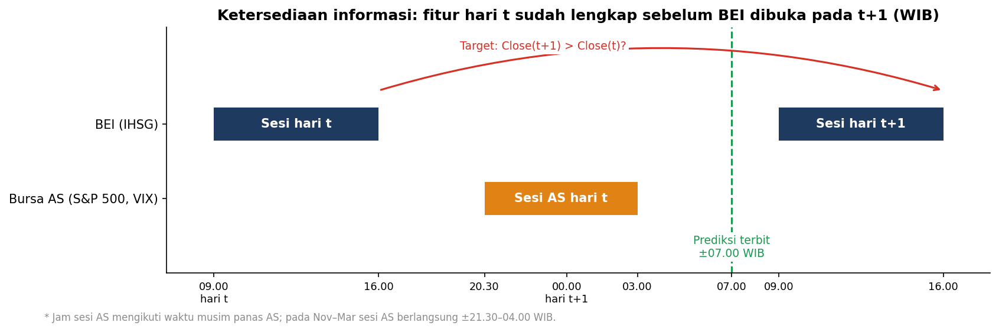
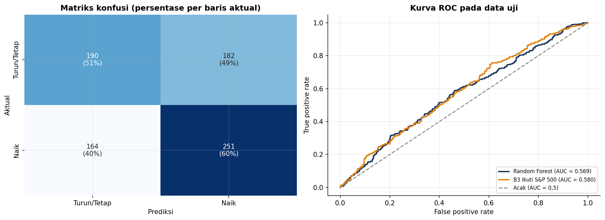
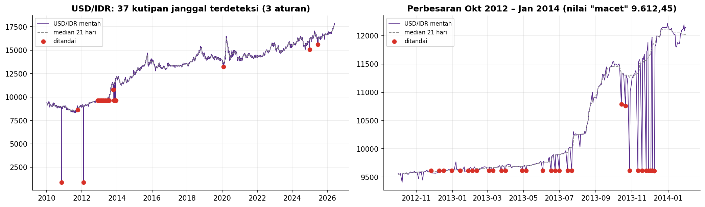

# Prediksi Arah Harian IHSG — Portofolio Ilmuwan Data

**Sertifikasi BNSP · LSP Digital Kreatif Solusi · Skema DSS.01.00.23 Ilmuwan Data (Data Scientist) · SKKNI No. 299 Tahun 2020**

**M. Syamsuddin Wisnubroto** — Institut Teknologi Sumatera (ITERA) · syamsuddin.wisnubroto@sd.itera.ac.id

> **Versi lengkap.** Data sampai 29 Mei 2026, dengan analisis yang lebih rinci. Versi utama yang lebih sederhana,
> dengan data sampai 30 September 2026, ada di
> [portfolio-ilmuwan-data](https://github.com/syamsuddinexcellent/portfolio-ilmuwan-data); angka hasil kedua versi berbeda.

---

## Ringkasan

Proyek ini menjawab satu pertanyaan bisnis: *apakah informasi pasar yang sudah tersedia sebelum Bursa Efek Indonesia
dibuka dapat memperkirakan apakah IHSG ditutup naik pada hari bursa berikutnya?*

BEI tutup pukul 16.00 WIB, sedangkan bursa AS berdagang pada malam harinya. Karena itu hasil sesi AS, harga komoditas,
dan kurs sudah diketahui sebelum BEI dibuka keesokan pagi. Proyek ini memakai **data nyata harian 2010 – Mei 2026**
(IHSG, S&P 500, VIX, minyak, emas, USD/IDR, suku bunga BI dan AS, inflasi) dan mengikuti seluruh siklus CRISP-DM, yang
dipetakan ke **11 unit kompetensi SKKNI 299/2020**.



## Hasil utama (data uji 25 Jan 2023 – 26 Mei 2026, 787 hari bursa yang tidak pernah dilihat model)

| Model / baseline | Accuracy | F1-macro | ROC-AUC |
|---|---|---|---|
| **Random Forest (model final)** | **0,560** | **0,558** | **0,569** |
| B3 — aturan "ikuti arah S&P 500 semalam" | 0,553 | 0,550 | 0,580 |
| B2 — tebakan acak berstrata | 0,513 | 0,510 | 0,511 |
| B1 — selalu menebak kelas mayoritas | 0,527 | 0,345 | 0,500 |

| Kriteria sukses teknis (ditetapkan di Unit 2, sebelum pemodelan) | Status |
|---|---|
| T1 Accuracy ≥ 0,55 | ✅ Lulus (0,560) |
| T2 F1-macro ≥ 0,55 | ✅ Lulus (0,558) |
| T3 ROC-AUC ≥ 0,58 | ❌ Tidak lulus (0,569) |
| T4 Mengalahkan baseline mayoritas dan acak | ✅ Lulus |
| T5 Tanpa kebocoran data (uji *point-in-time* + *purging*) | ✅ Lulus |

**Keputusan review (Unit 11): belum lanjut ke pilot.** Model mengalahkan baseline naif, tetapi kinerjanya praktis setara
dengan aturan sederhana "ikuti arah S&P 500". Hasil ini dilaporkan apa adanya: model tidak disetel ulang setelah melihat
data uji, karena hal itu akan membuat evaluasi bias.



## Temuan penting

**Tentang pasar**
- Prediktor terkuat IHSG besok adalah **return S&P 500 pada sesi hari yang sama** (ρ Spearman +0,29). Peluang IHSG naik
  besok 63,8% bila S&P 500 naik semalam vs 43,2% bila turun; arah hubungan ini konsisten di **13 dari 13 tahun** periode
  eksplorasi. VIX menunjukkan pola kebalikannya (−18,0 poin).
- Hari yang diprediksi "naik" memiliki rata-rata return IHSG hari berikutnya +0,14%, sedangkan hari yang diprediksi
  "turun" −0,19% (uji Welch p < 0,001). Ini mengukur kualitas informasi, **bukan** keuntungan trading.

**Tentang kualitas data (ditemukan di Unit 4, diperbaiki di Unit 6)**
- **37 kutipan USD/IDR rusak**, mis. 888,11 (1 Nov 2010) dan nilai "macet" 9.612,45 yang muncul pada 28 tanggal terpisah
  (Nov 2012 – Des 2013). Dideteksi dengan tiga aturan: penyimpangan dari median 21 hari, kutipan macet, dan
  lonjak-lalu-kembali. Lonjakan nyata saat krisis COVID-19 (24 Mar 2020) tidak ikut tertandai.
- **Harga minyak −37,63 USD** pada 20 Apr 2020 (peristiwa nyata kontrak WTI) yang membuat return persentase tidak bermakna.
- **300 hari libur BEI** yang nilai IHSG-nya disalin dari hari sebelumnya; jika dibiarkan akan menjadi label palsu.
- ***Look-ahead bias*:** `CPI` berisi inflasi tahunan yang sudah tercantum sejak 1 Januari (bahkan untuk 2026), dan
  `US_rate`/`BI_rate` diisi sejak awal bulan. CPI dikeluarkan; suku bunga memakai nilai yang berlaku di akhir bulan sebelumnya.



**Tentang model (review kritis)**
- Selisih F1 data latih vs validasi silang 0,123 menandakan *overfitting*; tuning memilih pohon lebih dalam untuk kenaikan
  F1 hanya +0,0008. Rekomendasi: aturan parsimoni (*one-standard-error rule*).
- `rate_spread` (BI rate − Fed rate) pada periode uji berada di luar rentang data latih (0,42–1,52 vs 1,40–7,64; PSI 8,4),
  sehingga tidak berguna bagi model berbasis pohon.

## Pemetaan 11 unit kompetensi

| No | Kode unit | Unit kompetensi | Notebook | Bukti utama |
|---|---|---|---|---|
| 1 | J.62DMI00.001.1 | Menentukan Objektif Bisnis | [01](notebooks/01_business_objective.ipynb) | Pemangku kepentingan, tujuan & kriteria sukses bisnis B1–B4 |
| 2 | J.62DMI00.002.1 | Menentukan Tujuan Teknis Data Science | [02](notebooks/02_technical_objective.ipynb) | Rumusan target, KPI T1–T5, strategi validasi deret waktu |
| 3 | J.62DMI00.005.1 | Menelaah Data | [03](notebooks/03_data_review.ipynb) | Frekuensi pembaruan, distribusi return, korelasi lead–lag |
| 4 | J.62DMI00.006.1 | Memvalidasi Data | [04](notebooks/04_data_validation.ipynb) | Kartu skor 6 dimensi, log 339 anomali, uji *point-in-time* |
| 5 | J.62DMI00.007.1 | Menentukan Objek Data | [05](notebooks/05_data_object.ipynb) | Unit analisis, seleksi record & atribut, uji chi-kuadrat |
| 6 | J.62DMI00.008.1 | Membersihkan Data | [06](notebooks/06_data_cleaning.ipynb) | 6 langkah terdokumentasi, 7 uji verifikasi otomatis |
| 7 | J.62DMI00.009.1 | Mengkonstruksi Data | [07](notebooks/07_data_construction.ipynb) | 16 fitur, split kronologis + *purging*, uji kebocoran |
| 8 | J.62DMI00.012.1 | Membangun Skenario Model | [08](notebooks/08_model_scenario.ipynb) | `TimeSeriesSplit`, 3 baseline + 5 algoritma, aturan pemilihan |
| 9 | J.62DMI00.013.1 | Membangun Model | [09](notebooks/09_model_building.ipynb) | Validasi silang, *grid search*, diagnosis *overfitting* |
| 10 | J.62DMI00.014.1 | Mengevaluasi Hasil Pemodelan | [10](notebooks/10_model_evaluation.ipynb) | KPI, baseline, ROC, *permutation importance*, stabilitas per tahun |
| 11 | J.62DMI00.015.1 | Melakukan Proses Review Pemodelan | [11](notebooks/11_model_review.ipynb) | Review proses, *drift* (PSI), keterbatasan, rencana penerapan |

Versi HTML setiap notebook (dengan seluruh output dan grafik) tersedia di folder [`html_output/`](html_output/).
Unit 1–11 juga tersedia dalam satu file: [`00_gabungan_unit_01-11.ipynb`](notebooks/00_gabungan_unit_01-11.ipynb)
(versi HTML: [`00_gabungan_unit_01-11.html`](html_output/00_gabungan_unit_01-11.html)).

## Struktur repositori

```
portfolio-ilmuwan-data/
├── data/
│   ├── raw/market_data.csv        # data mentah harian 2010–2026 (4.277 baris)
│   └── processed/                 # dihasilkan notebook 06–07 (tidak di-commit)
├── notebooks/                     # 01–11, satu notebook per unit kompetensi
├── html_output/                   # ekspor HTML notebook yang sudah dieksekusi
├── figures/                       # 24 grafik yang dihasilkan notebook
├── reports/                       # artefak antartahap (JSON/CSV): KPI, log anomali, log pembersihan, metrik
├── models/                        # metadata model & batas winsorization (file .pkl dihasilkan ulang)
├── presentation/                  # slide presentasi asesmen
└── requirements.txt
```

Setiap notebook membaca artefak dari tahap sebelumnya (mis. Unit 6 menjalankan log anomali Unit 4; Unit 10 membaca
ambang KPI dari Unit 2), sehingga angka di laporan tidak diketik ulang secara manual.

## Cara menjalankan

```bash
pip install -r requirements.txt
cd notebooks
for nb in 0*.ipynb 1*.ipynb; do jupyter nbconvert --to notebook --execute --inplace "$nb"; done
```

Notebook harus dijalankan berurutan (01 → 11). Total waktu eksekusi ± 3 menit; seluruh komponen acak memakai `random_state = 42`.

## Keterbatasan

Target adalah arah penutupan-ke-penutupan; informasi sesi AS sudah tercermin di harga pembukaan BEI, sehingga hasil ini
tidak dapat diartikan sebagai strategi trading yang menguntungkan. Data uji (Jan 2023 – Mei 2026) sudah dipakai untuk
evaluasi ini, sehingga perbaikan berikutnya harus dinilai dengan data baru setelah Mei 2026.

*Proyek ini adalah portofolio kompetensi data science dan bukan rekomendasi investasi.*
